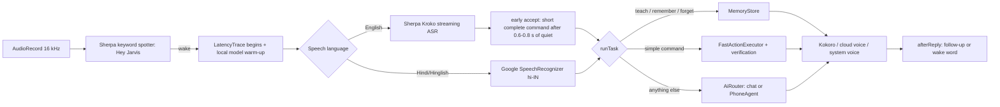
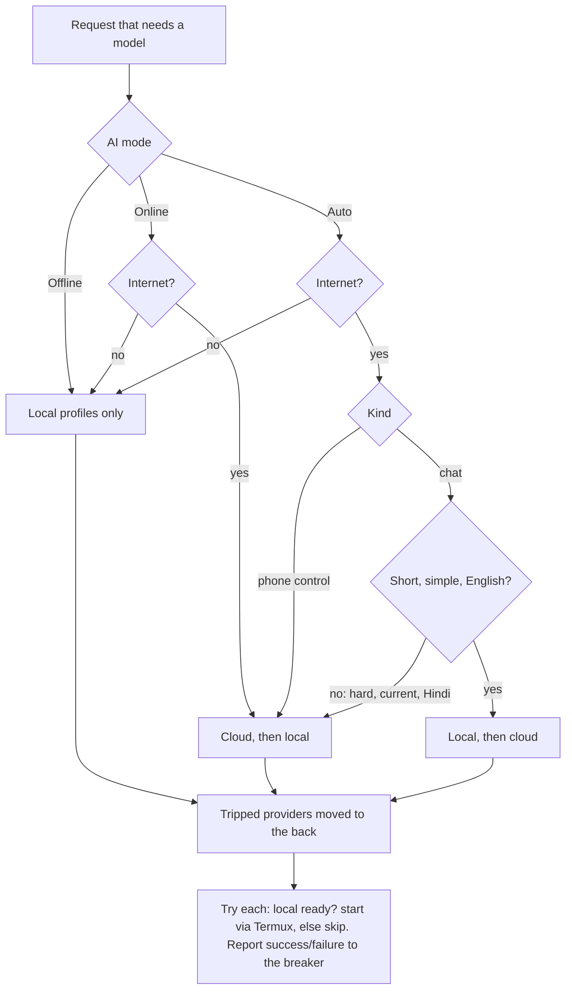
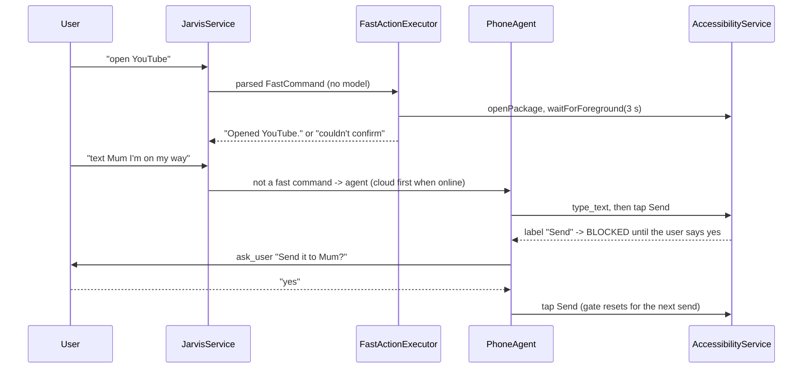
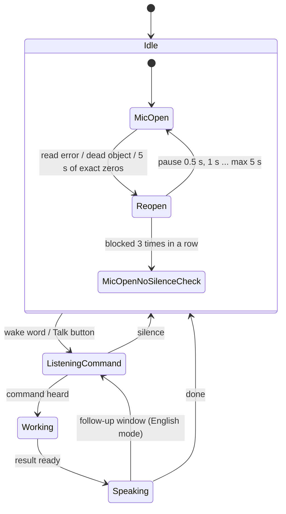
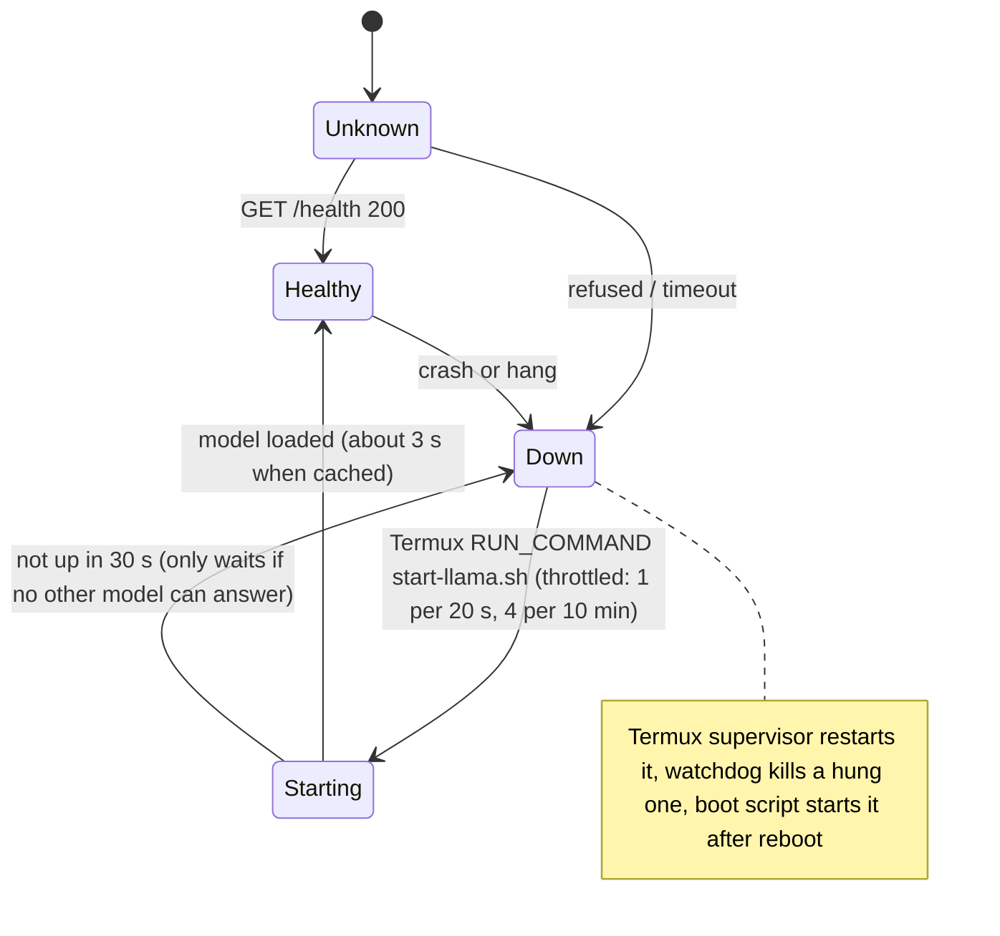
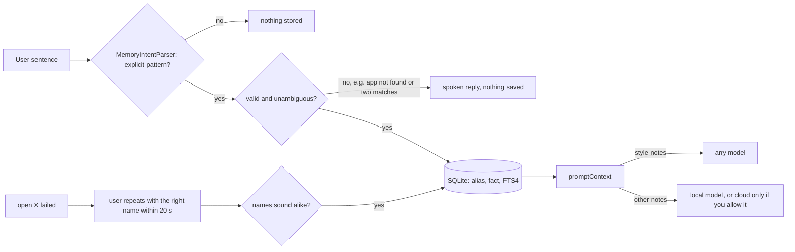

# Architecture

New code lives in four packages; the rest of the app keeps its structure.

| Package | What it does |
|---|---|
| `router/` | `Lexicon`, `FastCommandRouter`, `AppMatcher`, `MemoryIntentParser` (pure Kotlin, unit-tested) and `FastActionExecutor` (Android APIs) |
| `ai/` | `AiMode`, `RoutePolicy` + `CircuitBreaker` + `StartThrottle` (pure), `AiRouter`, `LocalServerManager`, `ServerHealth`, `LocalWarmup`, `ModelGate` |
| `memory/` | `MemoryStore` (SQLite), `MemoryPrompt` (pure), `MemoryActivity` |
| `agent/` | `SensitiveActions` (confirmation gate); `PhoneAgent` now takes a `ModelGate` |

## 1. Voice pipeline

## 2. AI routing

## 3. Phone-control execution

## 4. Microphone state machine

## 5. Local Qwen server lifecycle

## 6. Memory and learning

## Design decisions

**Local server: which approach?** (1) Termux + tmux + Boot alone restarts only at boot and cannot see a hung server (that is the script you had). (2) App-side supervision alone cannot start a process by itself. (3) Start-on-demand alone makes the first question wait. (4) Embedding llama.cpp via JNI would remove Termux but means shipping and maintaining native builds, more RAM inside the app process, and your existing Termux model/flags would be unused; nothing in your evidence says Termux is the problem, only that nothing restarts it. **Chosen: 1 + 2 + 3 together.** The Termux supervisor restarts crashes and hangs; the app checks health before every use, asks Termux to start it when down (throttled, never twice), warms it on "Hey Jarvis", and falls back to the cloud or reports why.

**Server flags** (from your server log: `n_parallel auto = 4` slots, prompt-cache limit 8192 MiB on a 7.4 GiB phone, `-c 2048`): one slot, 512 MiB cache, context 4096. Context 4096 costs about 117 MB of KV cache for this model (28 layers x 2 KV heads x 128 dims x 2 x 2 bytes = about 28 KB/token); prefill speed, not memory, is the real limit, so the prompt was also made smaller and cacheable instead of just making the window bigger.

**Why not a bigger/other model, openWakeWord, other ASR:** no measurement here shows a benefit. The measured weak points are Hindi quality (needs a different model family, not a bigger Qwen) and prefill speed (prompt size and caching).
