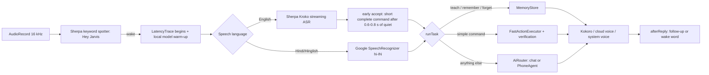
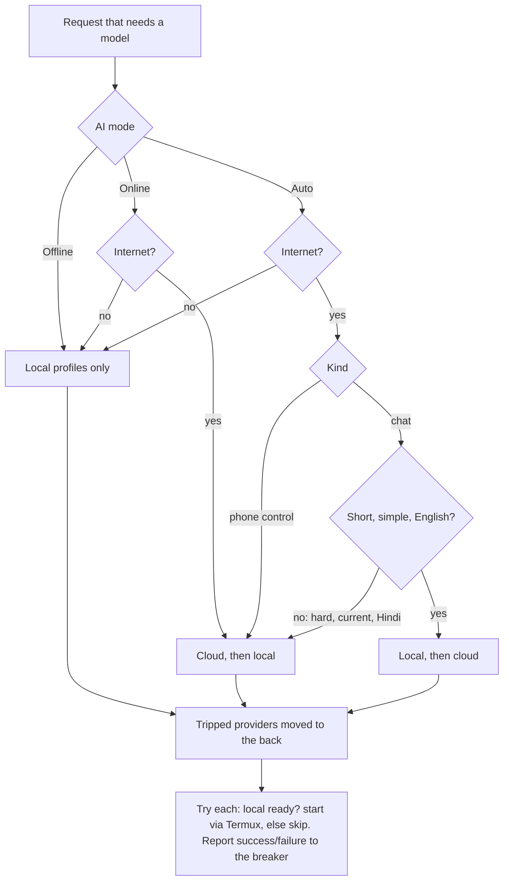
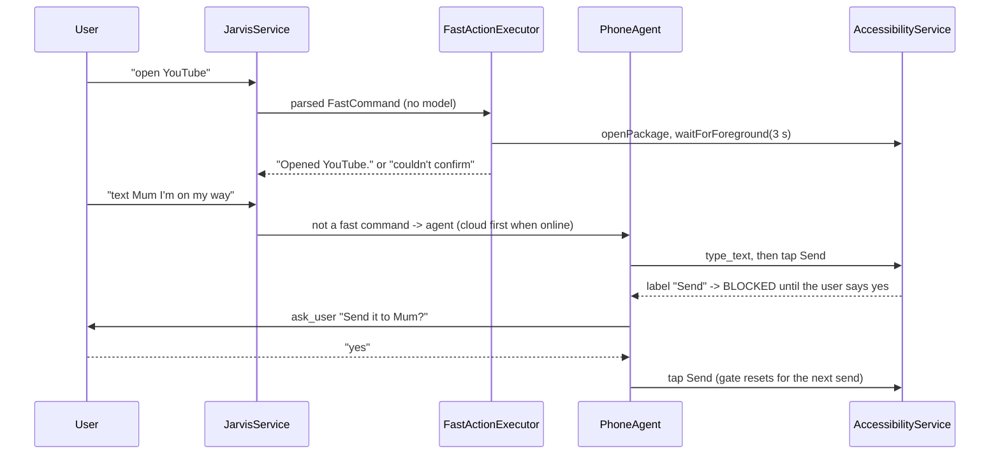
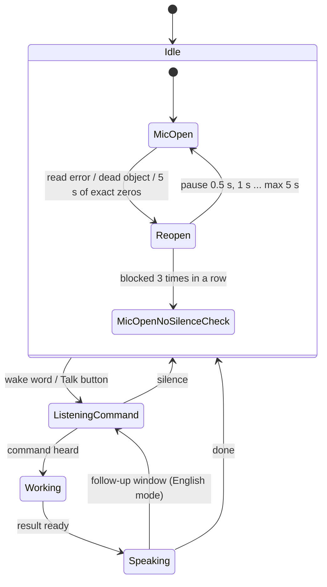
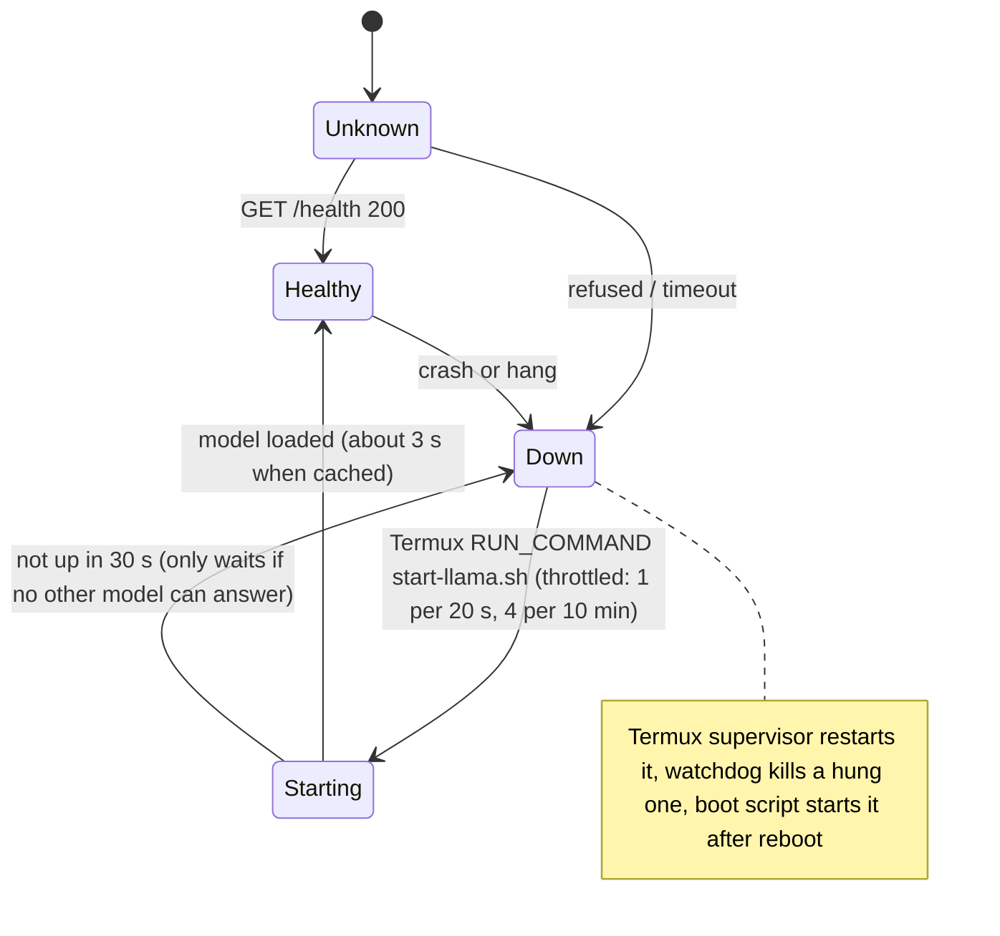
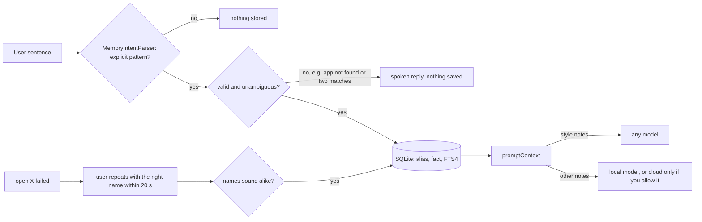
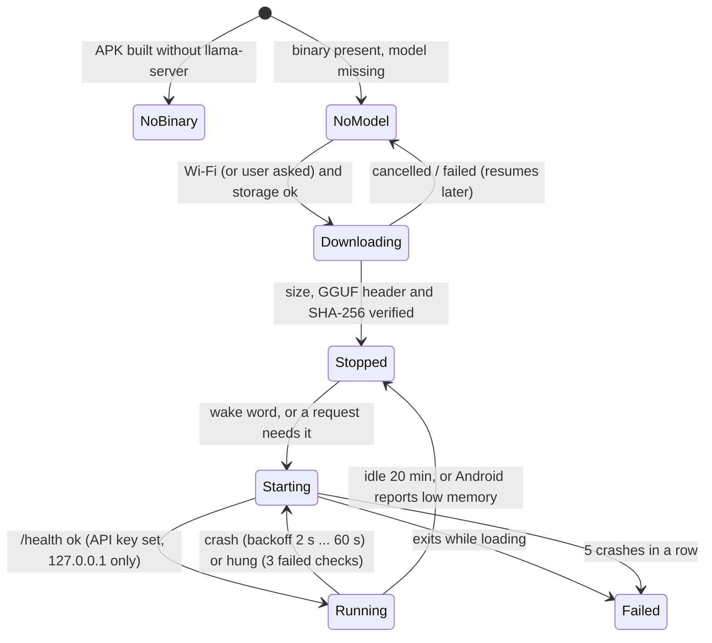
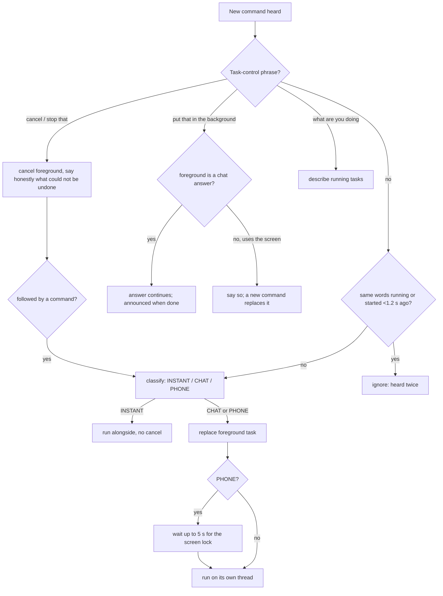

# Architecture

New code lives in four packages; the rest of the app keeps its structure.

| Package | What it does |
|---|---|
| `router/` | `Lexicon`, `FastCommandRouter`, `AppMatcher`, `MemoryIntentParser` (pure Kotlin, unit-tested) and `FastActionExecutor` (Android APIs) |
| `ai/` | `AiMode`, `RoutePolicy` + `CircuitBreaker` + `StartThrottle` (pure), `AiRouter`, `LocalServerManager`, `ServerHealth`, `LocalWarmup`, `ModelGate` |
| `memory/` | `MemoryStore` (SQLite), `MemoryPrompt` (pure), `MemoryActivity` |
| `agent/` | `SensitiveActions` (confirmation gate); `PhoneAgent` now takes a `ModelGate` |

## 1. Voice pipeline

## 2. AI routing

## 3. Phone-control execution

## 4. Microphone state machine

## 5. Local Qwen server lifecycle

## 6. Memory and learning

## Design decisions

**Local server: which approach?** (1) Termux + tmux + Boot alone restarts only at boot and cannot see a hung server (that is the script you had). (2) App-side supervision alone cannot start a process by itself. (3) Start-on-demand alone makes the first question wait. (4) Embedding llama.cpp via JNI would remove Termux but means shipping and maintaining native builds, more RAM inside the app process, and your existing Termux model/flags would be unused; nothing in your evidence says Termux is the problem, only that nothing restarts it. **Chosen: 1 + 2 + 3 together.** The Termux supervisor restarts crashes and hangs; the app checks health before every use, asks Termux to start it when down (throttled, never twice), warms it on "Hey Jarvis", and falls back to the cloud or reports why.

**Server flags** (from your server log: `n_parallel auto = 4` slots, prompt-cache limit 8192 MiB on a 7.4 GiB phone, `-c 2048`): one slot, 512 MiB cache, context 4096. Context 4096 costs about 117 MB of KV cache for this model (28 layers x 2 KV heads x 128 dims x 2 x 2 bytes = about 28 KB/token); prefill speed, not memory, is the real limit, so the prompt was also made smaller and cacheable instead of just making the window bigger.

**Why not a bigger/other model, openWakeWord, other ASR:** no measurement here shows a benefit. The measured weak points are Hindi quality (needs a different model family, not a bigger Qwen) and prefill speed (prompt size and caching).

---

# Second round: what was added

| Package | What it does |
|---|---|
| `runtime/` | `GgufDownloader` (resume, storage check, verification), `RuntimeConfig` + `RuntimePolicy` (command line, restart rules), `EmbeddedRuntime` (child process supervisor) |
| `contacts/` | `ContactMatcher` + `Translit` (pure), `ContactResolver`, `PermissionActivity` |
| `tasks/` | `TaskBoard`, `Interrupt`, `TaskControl` (pure); the service owns the threads |
| `apps/` | `AppAction` framework and `YouTubeAction` |
| `persona/` | `Persona`, `DailyGreeting` |
| `voice/` | `SentenceChunker`, `ReplyStreamer`; adaptive microphone mode in `VoiceInput` |
| `agent/` | `SseParser`; streaming in `OpenAiCompatibleSession`; `SensitiveActions` |

## On-device runtime lifecycle

## Tasks and interruption

A wake word while a task runs only opens the microphone: the task is replaced when a *command* is heard, not by a stray detection. A reply that arrives while the user is speaking is held, then spoken or dropped if a new command follows.

## Streamed speech
`OpenAiCompatibleSession` streams plain chat (`stream: true`); `SseParser` reads each line; `SentenceChunker` forms whole sentences (at least 24 characters, cut at `. ! ? ।`, not at decimals or "Dr."); `ReplyStreamer` speaks them one after another through the normal `say()`; the text of each sentence is shown as it is spoken. While one sentence is spoken, the streamer hands the next to `Speaker.prepare()`, and Kokoro makes it meanwhile, so it starts without a silence. Replies that use tools (phone control) are not streamed.

## Wake word: what the code audit found
- The keyword tokens in `VoiceInput` (`▁HE Y ▁JA R VI S`) were checked against the model's real `bpe.model`: they are the correct tokenization. No change needed there.
- The microphone was always opened with the *voice call* source and echo cancellation (the setting "interrupt by talking" is on by default). That path applies call-quality noise suppression and gain control to the signal, which commonly weakens quiet or distant speech. It is now used only while Jarvis speaks; idle listening uses the plain recognition source. This is a root-cause hypothesis from the code, **not measured** on your phone.
- The plain recognition source has no gain control, so a normal voice arrives far quieter than a shout, and the app's own gain was too slow and too small to lift a short "Hey Jarvis". `MicGain` now rests at the highest gain the room's noise allows (up to 32 times) and drops at once for loud sound. Measured with the real wake word model on synthetic speech (`RealEngineTestTuning`): 17/18 instead of 11/18 phrases heard at 1/40 volume in a quiet room, no false alarms. **Not measured** on a phone.
- Recovery from read errors, blocked microphone and thread overlap was added in the first round.
